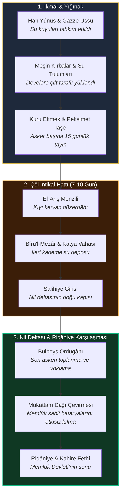

# `hadimul-harameyn`

<div align="center">

```
   __               ___                 __        __                                            
  / /  ___ _____   / _/__ __ __  __ __ / / ____  / /  ___ ________ ___ _  ___ __ _____           
 / _ \/ _ `/ _  | / _/ // // // // // // //___/ / _ \/ _ `/ __/ _ `/  ' \/ -_) // / _ \          
/_//_/\_,_/\_,_/ /_/ \_,_/ \_,_/ \_,_//_/      /_//_/\_,_/_/  \_,_/_/_/_/\__/\_, /_//_/          
                                                                            /___/               
```

### خادم الحرمين الشريفين السلطان سليم خان الأول
### *"Hâkimü’l-Haremeyn değil, bilakis Hâdimü’l-Haremeyni’ş-Şerîfeyn!"*
*(Cuma Hutbesi, Şam Emeviyye Camii, 27 Eylül 1516 / 1 Ramazan 922)*

<p align="center">
  <strong>I. Selim (Yavuz) Dönemi Askerî Sefer Güzergâhları, Coğrafi Bilgi Sistemleri (GIS / WGS84),<br>
  Birincil Kaynak Vakayinâmeleri ve Tarihsel Veri Mühendisliği Arşivi</strong>
</p>

[](https://github.com/bahattinyunus/hadimul-harameyn/actions)
[](LICENSE)
[](pyproject.toml)
[](data/routes/)
[](data/campaigns/)
[](data/primary-sources/)
[](data/quotes/)
[](CONTRIBUTING.md)

</div>

---

## 📌 1. Proje Vizyonu & Manifestosu

**`hadimul-harameyn`**, Osmanlı İmparatorluğu'nun 9. padişahı ve ilk Osmanlı halifesi **I. Selim (Yavuz Sultan Selim)** devrine (1512–1520) ait askerî intikalleri, meydan muharebelerini, menzil lojistiğini ve dönemin tanık metinlerini modern veri mühendisliği standartlarında (JSON, GeoJSON, CSV, Leaflet, Folium) modelleyen **uluslararası standartlarda açık kaynaklı bir dijital tarih ve tarihsel GIS platformudur.**

Proje; Çaldıran sahrasından Nil vadisine uzanan 3.800 kilometrelik ordu intikalini adım adım koordinatlandırarak (WGS84), dönemin ruznâme (sefer günlüğü), selimnâme ve diplomatik arşivleriyle çapraz doğrular. Sadece olayları sıralamakla kalmaz; su ikmal lojistiğini, top arabalarının taktik intikalini ve birincil kaynak metinlerini araştırmacılara, tarihçilere ve veri bilimcilere doğrudan analiz edilebilir şemalarla sunar.


---

## 📜 2. Birincil Kaynak Alıntıları & Tarihsel Kelâm Külliyatı

`data/quotes/historical-quotes.json` altında derlenen 25 birincil metin alıntısı, dönemin ruhunu, devlet felsefesini ve askeri psikolojisini yansıtır:

### 🕌 Hâdimü'l-Haremeyn ve Hilafet şuuru
> **Şam Emeviyye Camii Cuma Hutbesi (27 Eylül 1516):**  
> *"لا تقل حاكم الحرمين الشريفين، بل خادم الحرمين الشريفين"*  
> *"Hâkimü'l-Haremeyni'ş-Şerîfeyn dimeñüz, bilakis Hâdimü'l-Haremeyni'ş-Şerîfeyn diyü nidâ eyleñüz!"*  
> *(Bana Mekke ve Medine'nin Hâkimi demeyiniz; bilakis o iki mübarek mukaddes beldenin Hizmetkârı deyiniz!)*  
> — **Hoca Sâdeddin Efendi**, *Tâcü't-Tevârih*, Cilt IV, s. 260.

> **Kutsal Emanetlerin Karşılanması (1517):**  
> *"Kabe anahtarları ve Fahr-i Kâinât'ın mübârek emânetleri arz olundukta, Hünkâr gözyaşlarıyla secde-i şükrâna varup 'Bu devlet ve nîmet bize liyâkatimizden degil, Resûlullah'ın şefaatindendür' buyurdu."*  
> — **Hoca Sâdeddin Efendi**, *Tâcü't-Tevârih*, Cilt IV, s. 312.

---

### 👑 Cihan Hâkimiyeti & Devlet Aklı
> **Dünya Siyaseti Üzerine:**  
> *"Bu dünyâ bir pâdişâha yetecek kadar geniş ve büyük degildür; iki pâdişâha ise dardur."*  
> — **İbn Kemal (Kemalpaşazâde)**, *Tevârih-i Âl-i Osmân, IX. Defter*, s. 42.

> **Vezîriâzam Hadım Sinan Paşa'nın Şehadeti Üzerine Gözyaşları (Ridâniye, 1517):**  
> *"Mısır gibi bir iklîm aldık velâkin koca Sinân gibi bir vezîr-i bî-hemtâyı gâib eyledik. Mısır anuñ kadrine bahâ olamaz!"*  
> — **İbn Kemal**, *Tevârih-i Âl-i Osmân*, s. 270; **Celâlzâde Mustafa Çelebi**, *Selimnâme*, s. 188.

> **Osmanlı Hazine Mührü Vasiyeti (1520):**  
> *"Benüm altun ile toldurduğum hazîneyi bundan sonra her kimse evlâdımdan altun ile toldurursa kendü mührüyle mühürlesün; hilâf-ı takdîrde Hazîne-i Hümâyûn benüm mührümle mühürlensün!"*  
> — **Celâlzâde Mustafa Çelebi**, *Meâsir-i Selim Hânî*, s. 238.  
> *(İmparatorluğun 1922'deki feshine kadar Hazine-i Hümayun kapısı daima Yavuz mührüyle kapatılmıştır.)*

---

### ⚔️ Sefer Azmi & Askerî Şecaat
> **Çaldıran Öncesi Otağın Kurşunlanması ve Yeniçeriye Hitap (Eleşkirt, 1514):**  
> *"Biz buraya dönmek içün gelmedük! Karılarının koynuna girmek isteyenler dönsün; tek başıma dahi kalsam ben bu gazâ yolundan dönmem!"*  
> — **Celâlzâde Mustafa Çelebi**, *Selimnâme*, s. 98.

> **Sina Çölü Geçişinde Atından İnip Yaya Yürümesi (Ocak 1517):**  
> *"Padişah atından inip yayan yürümeye başlayınca asker de indi. Vezirler hayretle 'Hünkârım niçin yayan yürürsünüz?' diye sorduklarında fısıldadı: 'Görmez misiz, öñümüzde Fahr-i Kâinât aleyhissalâtü vesselâm piyâde yürürken biz nice süvâr olavuz?'"*  
> — **Hasan Can'ın doğrudan nakli**, **Hoca Sâdeddin Efendi**, *Tâcü't-Tevârih*, Cilt IV, s. 295.

---

### 🖋️ Şair Sultan: Divan-ı Selîmî
> **Kuru Kavga ve Dervişlik:**  
> *"Pâdişâh-ı âlem olmak bir kuru gavga imiş,*  
> *Bir velîye bende olmak cümleden a'lâ imiş."*  
> — **Selimî (I. Selim)**, *Dîvân-ı Selîm-i Evvel*.

> **İttihâd-ı İslâm ve Tefrika Feryadı:**  
> *"Milletümde ihtilâf ü tefrika endîşesi,*  
> *Kûşe-i kabrümde hattâ bî-karâr eyler beni.*  
> *İttihâdken savlet-i a'dâyı def'e çâremiz,*  
> *İttihâd etmezse millet dağ-dâr eyler beni."*  
> — **I. Selim**, *Mecmûa-i Eş'âr-ı Selîmî*.

> **Farsça Şaheser Gazelinden:**  
> *"Biz bülbül-i muhrik-dem-i gülzâr-ı firâkız,*  
> *Âteş kesilir geçse sabâ gülşenimizden."*  
> *(Biz ayrılık bahçesinin nefesi ateş saçan bülbülüyüz; sabah rüzgarı bahçemizden geçse cayır cayır yanar.)*  
> — **I. Selim**, *Dîvân-ı Sultân Selîm* (Haz. Paul Horn, Berlin 1904).

---

### 👁️ Çağdaş Doğu & Batı Gözlemcileri
> **Kahireli Vakayinüvis İbn İyâs'ın Gözüyle Yavuz (1517):**  
> *"Osmanlı Hükümdarı, heybet ve satvet sahibi, yuvarlak yüzlü, pos bıyıklı, çelik bakışlı bir sultandı. Sırtında debdebeli ipekler yerine sade yün bir aba vardı; fakat haşmetinden insanın dizlerinin bağı çözülürdü."*  
> — **İbn İyâs**, *Bedâi'u'z-Zuhûr fî Vekâi'i'd-Duhûr*, Cilt V, s. 148.

> **Venedik Senatosuna Sunulan İstihbarat Raporu (1516):**  
> *"Bu Türk Hünkârı, Büyük İskender'den daha hırslı ve Jül Sezar'dan daha cüretkârdır. Geceleri uyumayıp haritaları ve antik fatihlerin tarihlerini tetkik eder; bütün Asya'yı ve Afrika'yı tek bir imparatorluk yapmaya ant içmiştir."*  
> — **Marino Sanuto**, *I Diarii di Marino Sanuto*, Cilt 22, s. 412.

> **Kemalpaşazâde'nin 'İkindi Güneşi' Mersiyesi (1520):**  
> *"Güneş gibi idi ol pâdişâh-ı âlî-cenâb / Ziyâsı âleme dolmuş idi misâl-i âfitâb*  
> *Zamân-ı asr gibi idi devleti anuñ / Ziyâsı az idi lâkin zılâli pek tûlî..."*  
> *(O hükümdar ikindi vakti gibiydi; saltanatının zamanı az sürdü lakin bıraktığı tesir ve gölgesi pek uzun oldu.)*  
> — **Şeyhülislam Kemalpaşazâde**, *Mersiye-i Sultan Selim Han*.

---

## 🗺️ 3. Seferler & Meydan Muharebeleri Matrisi

Depoda şema (`schemas/campaign.schema.json`) doğrulamalı olarak kayıt altına alınan seferler:

| Sefer ID | Tarih | Muharebe / Sefer | Bölge | Kuvvetler (Osmanlı vs Rakip) | Taktik Doktrin | Veri Dosyası |
| :--- | :---: | :--- | :--- | :--- | :--- | :---: |
| `CMP-1514-CALDIRAN` | 1514-08-23 | **Çaldıran Meydan Muharebesi** | Çaldıran Ovası, Maku | 65.000 vs 45.000 | Tabur Cengi, seyyar topçu ve tüfekli yeniçeri savunması | [`1514-caldiran.json`](data/campaigns/1514-caldiran.json) |
| `CMP-1515-TURNADAGI` | 1515-06-12 | **Turnadağı Muharebesi** | Turnadağı, Göksun | 35.000 vs 28.000 | Sarp dağ geçidi çevirmesi, Dulkadir ilhakı | [`1515-turnadagi.json`](data/campaigns/1515-turnadagi.json) |
| `CMP-1516-KOCHISAR` | 1516-04-28 | **Koçhisar (Hanik) Muharebesi** | Kızıltepe, Mardin | 28.000 vs 22.000 | Çapraz tüfek pususu & Kürt aşiret süvari kıskacı | [`1516-kochisir.json`](data/campaigns/1516-kochisir.json) |
| `CMP-1516-MERCIDABIK` | 1516-08-24 | **Mercidâbık Meydan Muharebesi** | Mercidâbık, Halep | 65.000 vs 55.000 | Sahra arabaları zinciri, Memlûk süvarisi imhası | [`1516-mercidabik.json`](data/campaigns/1516-mercidabik.json) |
| `CMP-1516-HANYUNUS` | 1516-12-21 | **Han Yûnus (Gazze) Muharebesi** | Han Yûnus, Filistin | 22.000 vs 18.000 | Çöl eşiği pusu kırma manevrası, Sina kapısı | [`1516-hanyunus.json`](data/campaigns/1516-hanyunus.json) |
| `CMP-1517-RIDANIYE` | 1517-01-22 | **Ridâniye Muharebesi & Kahire** | El-Mukattam, Kahire | 55.000 vs 45.000 | Mukattam Dağı arkalanarak sabit topların düşürülmesi | [`1517-ridaniye.json`](data/campaigns/1517-ridaniye.json) |

---

## 🐪 4. Sina Çölü İntikali Lojistik Boru Hattı

Sina Çölü intikali askeri tarihte eşi görülmemiş bir lojistik mühendislik başarısıdır:



---

## 📂 5. Dizin Mimarisi

```text
hadimul-harameyn/
├── .github/
│   └── workflows/
│       └── ci.yml                      # GitHub Actions otomatik şema ve harita test hattı
├── README.md                           # Proje manifestosu, alıntılar ve dokümantasyon
├── LICENSE                             # MIT Lisansı
├── CONTRIBUTING.md                     # Akademik veri katkı ve doğrulama yönergeleri
├── pyproject.toml                      # Modern Python paket yapılandırması (PEP 621)
├── requirements.txt                    # jsonschema, folium, pytest bağımlılıkları
│
├── data/
│   ├── campaigns/                      # Sefer parametreleri, kuvvetler, taktikler ve harp kayıtları
│   │   ├── 1514-caldiran.json          # Çaldıran Zaferi ve Tebriz intikali
│   │   ├── 1515-turnadagi.json         # Turnadağı Muharebesi ve Anadolu Türk birliği
│   │   ├── 1516-kochisir.json          # Koçhisar Muharebesi ve Mardin/Güneydoğu fethi
│   │   ├── 1516-mercidabik.json        # Mercidâbık Muharebesi ve Suriye'nin fethi
│   │   ├── 1516-hanyunus.json          # Han Yûnus Muharebesi ve Sina kapısı
│   │   └── 1517-ridaniye.json          # Sina intikali, Ridâniye ve Mısır'ın fethi
│   │
│   ├── routes/                         # Coğrafi Bilgi Sistemleri (GIS / GeoJSON)
│   │   ├── caldiran-expedition.geojson # İstanbul -> Sivas -> Tebriz menzil koordinatları (21 menzil)
│   │   └── egypt-conquest.geojson      # Halep -> Şam -> Gazze -> Sina -> Kahire hattı (19 menzil)
│   │
│   ├── timeline/                       # Standartlaştırılmış kronoloji verisi
│   │   ├── selim-i-chronology.csv      # 1512-1520 arası 39 kritik hadise
│   │   └── administrative-events.json  # 11 idari, hukuki ve dini ferman
│   │
│   ├── primary-sources/                # Birincil metin dizinleri ve bibliyografya
│   │   ├── selimnameler-index.json     # 11 Selimnâme (Celâlzâde, İbn Kemal, İdris, Hoca Sâdeddin vb.)
│   │   └── contemporary-records.json   # 7 Çağdaş vesika (İbn İyâs, Marino Sanuto, TSMA Arşivi vb.)
│   │
│   └── quotes/                         # Birincil tarihsel alıntılar ve kelâm külliyatı
│       └── historical-quotes.json      # 25 doğrulanmış epigraf, Osmanlıca metin ve felsefi şerh
│
├── schemas/                            # JSON Schema standartları (Draft-07)
│   ├── campaign.schema.json            # Sefer veri şeması
│   ├── route-node.schema.json          # Menzil ve GeoJSON şeması
│   ├── timeline.schema.json            # Kronoloji ve idari hadise şeması
│   ├── primary-sources.schema.json     # Birincil kaynak fihrist şeması
│   └── quotes.schema.json              # Tarihsel alıntılar şeması
│
├── tools/                              # Veri işleme, test ve haritalama scriptleri
│   ├── validate_data.py                # Schema & GeoJSON bütünlük denetim motoru
│   └── generate_route_map.py           # GeoJSON -> Leaflet / Folium interaktif harita üretici
│
├── tests/                              # Pytest birim ve entegrasyon testleri
│   ├── conftest.py
│   ├── test_validation.py
│   ├── test_routes.py
│   └── test_maps.py
│
└── build/                              # Üretilen HTML haritaları ve web portalı
    ├── index.html                      # Sefer haritaları ana portalı ve alıntı vitrini
    ├── caldiran-campaign-map.html      # Çaldıran interaktif Leaflet haritası
    ├── caldiran-folium.html            # Çaldıran Folium katmanı
    ├── egypt-campaign-map.html         # Mısır interaktif Leaflet haritası
    └── egypt-folium.html               # Mısır Folium katmanı
```

---

## ⚡ 6. Hızlı Başlangıç

### 1. Depoyu Klonlayın
```bash
git clone https://github.com/bahattinyunus/hadimul-harameyn.git
cd hadimul-harameyn
```

### 2. Bağımlılıkları Yükleyin
```bash
pip install -r requirements.txt
```

### 3. Veri Doğrulama Motorunu Çalıştırın
```bash
python tools/validate_data.py
```

### 4. Testleri Koşun
```bash
pytest tests/ -v
```

### 5. İnteraktif Haritaları ve Portalı Derleyin
```bash
python tools/generate_route_map.py --campaign all
```

Derlenen `build/index.html` dosyasını doğrudan herhangi bir tarayıcıda açarak menzil simülasyonlarını izleyebilir, menzil kartlarını tetkik edebilir ve birincil kaynak alıntı vitrinini deneyimleyebilirsiniz.

---

## 📚 7. Akademik Kaynakça

Projedeki her menzil koordinatı, hicri tarih ve muharebe taktiği aşağıdaki birincil ve çağdaş kaynaklarla çapraz doğrulanmıştır:

1. **Kemalpaşazâde (Şemseddin Ahmed İbn Kemal):** *Tevârih-i Âl-i Osmân*, IX. Defter (Haz. Şerafettin Turan, TTK).
2. **Celâlzâde Mustafa Çelebi (Koca Nişancı):** *Selimnâme (Meâsir-i Selim Hânî)* (Haz. Ahmet Uğur - Mustafa Çuhadar, MEB/TTK).
3. **Mevlânâ Hakîmüddîn İdrîs-i Bitlisî:** *Selim-nâme (Selim Şahnâme)* (Çev. Hicabi Kırlangıç, TTK).
4. **Hoca Sâdeddin Efendi:** *Tâcü't-Tevârih*, Cilt IV - V (Kültür Bakanlığı Yayınları).
5. **Haydar Çelebi:** *Ruznâme-i Sefer-i Hümâyûn* (Topkapı Sarayı Müzesi Arşivi Nu. E. 1234).
6. **Muhammed b. Ahmed İbn İyâs:** *Bedâi'u'z-Zuhûr fî Vekâi'i'd-Duhûr*, Cilt IV - V (Franz Steiner Verlag).
7. **Marino Sanuto:** *I Diarii di Marino Sanuto*, Cilt 18 - 29 (Venedik Devlet Arşivi).
8. **Feridun Ahmed Bey:** *Münşeâtü's-Selâtîn*, 2 Cilt (Takvimhâne-i Âmire, İstanbul 1264).
9. **Lutfi Paşa:** *Tevârih-i Âl-i Osmân* (Kültür Bakanlığı Yayınları).
10. **Şükrî-i Bitlisî:** *Selimnâme (Fütûhât-ı Selîmî)* (Haz. Mustafa Argunşah, EÜ Yayınları).
11. **Keşfî Mehmed Çelebi:** *Selimnâme* (Süleymaniye Kütüphanesi, Esad Efendi Nu. 2147).
12. **Sûzî Çelebi:** *Gazavatnâme-i Sultan Selim* (TTK Yayınları).
13. **İshak Çelebi:** *Selimnâme* (TSMK Revan Nu. 1279).
14. **Sa'dî b. Tevfîk:** *Selimnâme (Feth-i Diyâr-ı Mısr)* (TSMK Bağdat Nu. 285).
15. **Muhyî-i Gülşenî:** *Menâkıb-ı İbrâhîm-i Gülşenî* (Haz. Tahsin Yazıcı, TTK).
16. **Seyyid Lokman:** *Hünernâme*, Cilt II (TSMK Hazine Nu. 1524).
17. **Caterino Zeno & Angiolello:** *A Narrative of Italian Travels in Persia* (Hakluyt Society).
18. **Prof. Dr. Feridun M. Emecen:** *Yavuz Sultan Selim* (Yitik Hazine Yayınları / Kapı Yayınları).

---

## 🤝 8. Katkı Sağlama (Contributing)

Katkı sağlamak isteyen araştırmacılar için yönergeler [CONTRIBUTING.md](CONTRIBUTING.md) dosyasında sunulmuştur. Şemaya uygun her katkı (`validate_data.py` ve `pytest`) CI tarafından otomatik olarak doğrulanır.

---

## 📄 9. Lisans

Bu proje **[MIT Lisansı](LICENSE)** altında açık kaynaklı olarak yayımlanmıştır.

```text
Hâdimü'l-Haremeyni'ş-Şerîfeyn :: Mekke ve Medine'nin Hizmetkârı
1512 — Yavuz Sultan Selim — 1520
```
