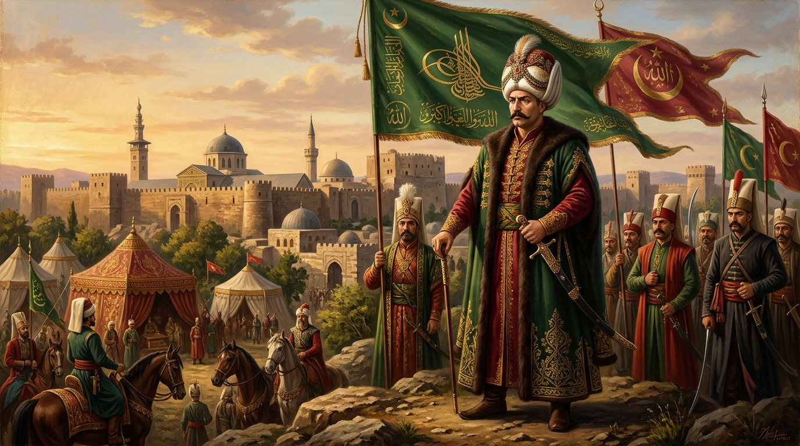
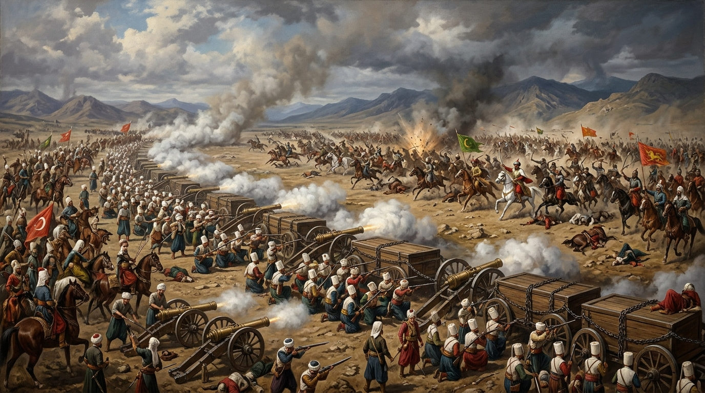
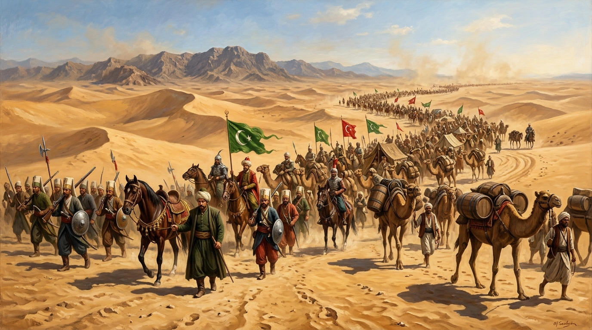
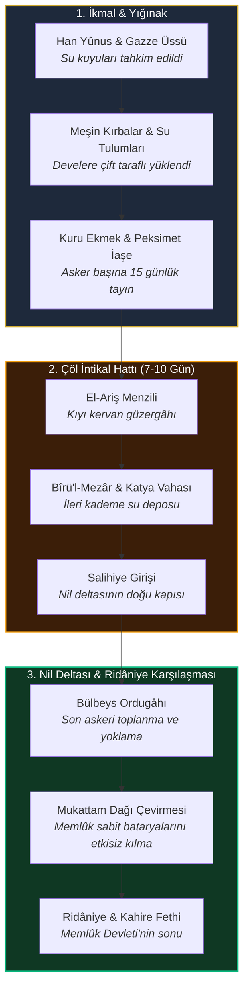

# `hadimul-harameyn`

<div align="center">

```
   __               ___                 __        __                                            
  / /  ___ _____   / _/__ __ __  __ __ / / ____  / /  ___ ________ ___ _  ___ __ _____           
 / _ \/ _ `/ _  | / _/ // // // // // // //___/ / _ \/ _ `/ __/ _ `/  ' \/ -_) // / _ \          
/_//_/\_,_/\_,_/ /_/ \_,_/ \_,_/ \_,_//_/      /_//_/\_,_/_/  \_,_/_/_/_/\__/\_, /_//_/          
                                                                            /___/               
```

### خادم الحرمين الشريفين السلطان سليم خان الأول
### *"Hâkimü’l-Haremeyn değil, bilakis Hâdimü’l-Haremeyni’ş-Şerîfeyn!"*
*(Cuma Hutbesi, Şam Emeviyye Camii, 27 Eylül 1516 / 1 Ramazan 922)*

<p align="center">
  <strong>I. Selim (Yavuz Sultan Selim) Dönemi Askerî Sefer Güzergâhları, Coğrafi Bilgi Sistemleri (GIS / WGS84),<br>
  Birincil Kaynak Vakayinâme Metinleri ve Tarihsel Kelâm Külliyatı Arşivi</strong>
</p>

[](https://github.com/bahattinyunus/hadimul-harameyn/actions)
[](LICENSE)
[](pyproject.toml)
[](data/routes/)
[](data/campaigns/)
[](data/primary-sources/)
[](data/quotes/)
[](CONTRIBUTING.md)

<div align="center" style="margin-top: 20px;">
  
  <p><em>«خادم الحرمين الشريفين» — Şam Emeviyye Camii ve Otağ-ı Hümâyûn Önünde I. Selim (1516–1517)</em></p>
</div>

</div>

---

## 📌 1. Proje Vizyonu & Manifestosu

**`hadimul-harameyn`**, Osmanlı İmparatorluğu'nun 9. padişahı ve ilk Osmanlı halifesi **I. Selim (Yavuz Sultan Selim)** devrine (1512–1520) ait askeri intikalleri, menzil lojistiğini, meydan muharebelerini ve birincil kaynak metinlerini yapılandırılmış veri formatlarında (JSON, GeoJSON, CSV, Leaflet, Folium) bir araya getiren **uluslararası standartlarda açık kaynaklı bir dijital tarih ve tarihsel veri mühendisliği arşividir.**

Proje; Çaldıran sahrasından Nil vadisine uzanan 3.800 kilometrelik ordu intikalini menzil menzil koordinatlandırarak (WGS84), dönemin menzilnâme, ruznâme (sefer günlüğü) ve diplomatik mecmualarıyla çapraz doğrular. Sadece statik vakaları listelemekle kalmaz; çölde su ikmal kervanlarının organizasyonundan sahra top arabalarının zincirlenmesine kadar dönemin askerî aklını ve birinci el şahitliklerini araştırmacılara, tarih meraklılarına ve veri bilimcilere doğrudan analiz edilebilir şemalarla sunar.


---

## 📜 2. Birincil Kaynak Alıntıları & Tarihsel Sözler Antolojisi

Aşağıdaki metinler, [`data/quotes/historical-quotes.json`](data/quotes/historical-quotes.json) veri tabanında yapılandırılmış ve şema onaylı olarak saklanan 50 tarihî epigraf ve tanıklığın derlemesidir:

---

### Bölüm I: 🕌 Hâdimü'l-Haremeyn, Hilafet & Kutsal Emanetler

> **[QTE-001] Şam Emeviyye Camii Cuma Hutbesi (27 Eylül 1516):**  
> *"لا تقل حاكم الحرمين الشريفين، بل خادم الحرمين الشريفين"*  
> *"Hâkimü'l-Haremeyni'ş-Şerîfeyn dimeñüz, bilakis Hâdimü'l-Haremeyni'ş-Şerîfeyn diyü nidâ eyleñüz!"*  
> *(Bana Mekke ve Medine'nin Hâkimi demeyiniz; bilakis o iki mübarek mukaddes beldenin Hizmetkârı deyiniz!)*  
> — **Hoca Sâdeddin Efendi**, *Tâcü't-Tevârih*, Cilt IV, s. 260; **Celâlzâde Mustafa Çelebi**, *Selimnâme*, s. 152.

> **[QTE-022] Kutsal Emanetlerin Karşılanışı ve Şükür Secdesi (1517):**  
> *"Haremeyn anahtarları ve Fahr-i Kâinât'ın mübârek emânetleri arz olundukta, Hünkâr gözyaşlarıyla secde-i şükrâna varup 'Bu devlet ve nîmet bize liyâkatimizden degil, Resûlullah'ın şefaatindendür' buyurdu."*  
> — **Hoca Sâdeddin Efendi**, *Tâcü't-Tevârih*, Cilt IV, s. 312.

> **[QTE-004] Sina Çölü'nde Yaya Yürüyüş Menkıbesi (Ocak 1517):**  
> *"Padişah atından inip yayan yürümeye başlayınca asker de indi. Vezirler hayretle 'Hünkârım niçin yayan yürürsünüz?' diye sorduklarında fısıldadı: 'Görmez misiz, öñümüzde Fahr-i Kâinât aleyhissalâtü vesselâm piyâde yürürken biz nice süvâr olavuz?'"*  
> — **Hasan Can'ın doğrudan nakli**, **Hoca Sâdeddin Efendi**, *Tâcü't-Tevârih*, Cilt IV, s. 295.

---

### Bölüm II: 👑 Cihan Hâkimiyeti, Devlet Aklı & Mülk Siyaseti

> **[QTE-002] Cihanşümul Hâkimiyet Mefkûresi:**  
> *"این جهان یک پادشاه را بسنده نیست و دو پادشاه را تنگ است"*  
> *"Bu dünyâ bir pâdişâha yetecek kadar geniş ve büyük degildür; iki pâdişâha ise dardur."*  
> *(Bu dünya tek bir hükümdara yetecek kadar büyük değildir; iki hükümdara ise dardır.)*  
> — **İbn Kemal (Kemalpaşazâde)**, *Tevârih-i Âl-i Osmân, IX. Defter*, s. 42.

> **[QTE-003] Hadım Sinan Paşa'nın Şehadeti Üzerine Feryat (Ridâniye, 1517):**  
> *"مصر كبى بر اقليم الدق ولاكن قوجه سنان كبى بر وزير بيمثالى غائب ايلدك. مصر آنك قدرينه بها اولامز!"*  
> *"Mısır gibi bir iklîm aldık velâkin koca Sinân gibi bir vezîr-i bî-hemtâyı gâib eyledik. Mısır anuñ kadrine bahâ olamaz!"*  
> *(Mısır gibi koskoca bir memleketi fethettik lakin koca Sinan gibi eşsiz bir veziri kaybettik. Mısır onun kıymetine bedel olamaz!)*  
> — **İbn Kemal**, *Tevârih-i Âl-i Osmân*, s. 270; **Celâlzâde**, *Selimnâme*, s. 188.

> **[QTE-005] Osmanlı Hazine Mührü Vasiyeti (1520):**  
> *"Benüm altun ile toldurduğum hazîneyi bundan sonra her kimse evlâdımdan altun ile toldurursa kendü mührüyle mühürlesün; hilâf-ı takdîrde Hazîne-i Hümâyûn benüm mührümle mühürlensün!"*  
> *(Benim altınla doldurduğum devlet hazinesini bundan sonra evlatlarımdan ve torunlarımdan her kim altınla doldurursa kendi mührüyle mühürlesin; aksi takdirde Hazine-i Hümâyûn kıyamete dek benim mührümle mühürlensin!)*  
> — **Celâlzâde Mustafa Çelebi**, *Meâsir-i Selim Hânî*, s. 238; **İbn Kemal**, *IX. Defter*, s. 310.  
> *(Osmanlı İmparatorluğu'nun feshine kadar Topkapı Sarayı İç Hazine kapısı daima Yavuz mührüyle açılıp kapatılmıştır.)*

> **[QTE-015] Haliç Tersanesi ve Deniz Gücü Fermanı (1519):**  
> *"Eger karada olduğu gibi deryâda dahi donanmamız cihanı tutmazsa, ehl-i küffâr ve korsanlar İslâm beldelerini tâcizden geri durmaz. Haliç'te üç yüz gözlü bir tersâne bünyâd oluna!"*  
> — **Lutfi Paşa (Osmanlı Vezîriâzamı)**, *Tevârih-i Âl-i Osmân*, s. 280.

> **[QTE-045] Kaptanıderya'ya Deniz Ufku Talimatı (1519):**  
> *"Osmanlı'nın ufku karalarla mahdud degildür; deryâlar dahi adaletimize boyun eğecek, Akdeniz İslam gölü oluncaya dek gemi tezgâhları uyumaya!"*  
> — **Lutfi Paşa**, *Tevârih-i Âl-i Osmân*, s. 282.

> **[QTE-027] Pederi Sultan II. Bayezid'in Tahttan Feragat Ederken Duası (1512):**  
> *"Benden sonra saltanat senündür oğul! Kılıcın keskin, ömrün az olsun; devleti adaletle şerefyâb eyleyesin!"*  
> — **İbn Kemal**, *Tevârih-i Âl-i Osmân (IX. Defter)*, s. 18; **Hoca Sâdeddin**, Cilt IV, s. 182.

> **[QTE-034] Tebriz Sarayı'nda Sanat ve İlim Erbabına Hitap (1514):**  
> *"Tebriz'in ehl-i hüneri ve üstâd-ı fenni bilsünler ki; mülkümüzde canları, malları ve sanatları azizdir. Cümlesi pâyitaht-ı İslâm İstanbul'da baş tâcı oluna!"*  
> — **Haydar Çelebi**, *Ruznâme-i Sefer-i Hümâyûn*, s. 72.

> **[QTE-024] Vezîriâzam Yunus Paşa'nın İdamında Devlet Disiplini (1517):**  
> *"Devlet kararlarını tahkîr idüp hünkâra akıl öğretmeye kalkanın, vezîr dahi olsa kellesi omuzuna yüktür!"*  
> — **Celâlzâde Mustafa Çelebi**, *Selimnâme*, s. 196; **İbn Kemal**, *s. 288*.

---

### Bölüm III: ⚔️ Harp Meydanları, Tabur Cengi & Askerî Şecaat

> **[QTE-007] Eleşkirt'te Otağın Kurşunlanması ve Yeniçeriye Hitap (1514):**  
> *"Biz buraya dönmek içün gelmedük! Karılarının koynuna girmek isteyenler dönsün; tek başıma dahi kalsam ben bu gazâ yolundan dönmem!"*  
> — **Celâlzâde Mustafa Çelebi**, *Selimnâme*, s. 98; **Hoca Sâdeddin**, Cilt IV, s. 202.

> **[QTE-032] Çaldıran'da Topçubaşına Verilen Sahra Topu Emri (1514):**  
> *"Top arabalarının zincirini berk eyleñ! Bir karış geriye adım atanın kellesini kendi destimle keserüm; ateş emri virilmedikçe namlu kıpırdamaya!"*  
> — **İbn Kemal (Kemalpaşazâde)**, *Tevârih-i Âl-i Osmân*, s. 195.

> **[QTE-026] Şehzadelik Yıllarından Trabzon Kılıç İlkesi (1508):**  
> *"Kılıcımız kınında paslanursa düşmanın gözü kararup haddini aşar; kılıç parıldadıkça küffâr ve fitne ehli titrer!"*  
> — **Hoca Sâdeddin Efendi**, *Tâcü't-Tevârih*, Cilt IV, s. 165.

> **[QTE-035] Kemah Kalesi Kuşatmasında Askeri İrade (1515):**  
> *"Fırat nehri kan akup dağlar taştan dökülse dahi bu sarp hisar düşecek; Fırat boyu emn ü emâna kavuşmadıkça geri dönülmeyecektir!"*  
> — **Celâlzâde Mustafa Çelebi**, *Selimnâme*, s. 125.

> **[QTE-023] Turnadağı Seferi Arifesinde Dulkadiroğlu'na Tavır (1515):**  
> *"Dulkadıroğlu pîr ü bî-vefâdur; arkamızdan ordugâhımızı yağmalatup düşmana casus salar. Mülk-i Rûm'da iki başlılık câiz degildür; fitne kökünden kazına!"*  
> — **İbn Kemal**, *Tevârih-i Âl-i Osmân*, s. 142.

> **[QTE-016] İdris-i Bitlisî'nin Güneydoğu Beyleri Raporu (1515):**  
> *"Kürdistan ümerâsı ve ulemâsı, kılıç zoruyla degil; Âl-i Osmân'ın şeriat ve adaletine duydukları ezelî muhabbet ve itimad ile hünkârın eteğine sarıldılar."*  
> — **Mevlânâ Hakîmüddîn İdrîs-i Bitlisî**, *Selim Şahnâme*, s. 195.

> **[QTE-020] Tih Sahrası'nın Su İkmal Defteri (Ocak 1517):**  
> *"On günde aşılamaz dinilen Tih Çölü'nde meşin kırbalarla su öyle taşındı ki askere bir katre susuzluk zahmeti dokunmadı; cümle mekkâri ve develer nehir gibi su akıttı."*  
> — **Haydar Çelebi**, *Ruznâme-i Sefer-i Hümâyûn*, TSMA E. 1234, s. 472.

> **[QTE-039] Sina Çölü'nde Kum Fırtınasında Askere Sesleniş (1517):**  
> *"Sabr idesiz gâzilerim! Tih Sahrası çetindir velâkin Hak teâlânın inayetiyle Nil'in suları önümüzde, feth-i celîl elimizdedir!"*  
> — **Haydar Çelebi**, *Ruznâme*, s. 104; **Celâlzâde**, s. 170.

> **[QTE-019] Mukattam Dağı Çevirme Manevrası (Ridâniye, 1517):**  
> *"Memlûk askeri toplarını sâbit idüp cepheden hücûm beklerken, Hünkâr Mukattam Dağı'nı arkadan dolanup düşmanı şaşkına çevirdi; top namluları boşa çıkup feth-i celîl müyesser oldu."*  
> — **Celâlzâde Mustafa Çelebi**, *Meâsir-i Selim Hânî*, s. 182.

---

### Bölüm IV: 📜 Diplomatik Nâmeler & Mektuplaşmalar (Münşeâtü's-Selâtîn)

> **[QTE-006] Şah İsmail'e Birinci Sert Mektup (1514):**  
> *"Ben ki ser-leşker-i muzaffer-i İslâm ve şikest-i bünyâd-ı ehl-i bid'at olan Sultân Selîm Şâh bin Bâyezîd Hân'ım... Er isen meydâna gelesin, intizâr eylemeyesin!"*  
> — **Feridun Ahmed Bey**, *Münşeâtü's-Selâtîn*, Cilt I, s. 378.

> **[QTE-029] Şah İsmail'e İkinci Meydan Okuma (1514):**  
> *"Er meydanından kaçup dağ arkasına gizlenmek şahlara şan degildür; nâmertlik libâsını çıkarup saf saf dizilen asker önüne çıkasın!"*  
> — **Feridun Ahmed Bey**, *Münşeâtü's-Selâtîn*, Cilt I, s. 385.

> **[QTE-030] Şah İsmail'in Yavuz'a Afyon Kutusuyla Cevabı (1514):**  
> *"İhtimal ki bu kelâm-ı bî-edebâne afyon tiryakisi olan kâtiplerinizin akl-ı perişanından çıkmış ola; size altın hokka içinde afyon hediye gönderdik."*  
> — **Feridun Ahmed Bey**, *Münşeâtü's-Selâtîn*, Cilt I, s. 392.

> **[QTE-031] Yavuz'un Afyon Kutusuna Çaldıran Meydanında Cevabı (1514):**  
> *"Bizim mektubumuz hakikat şerbetidür; sen afyonun tesirini meydan-ı harbde toplar gürledükte göreceksin!"*  
> — **Celâlzâde Mustafa Çelebi**, *Selimnâme*, s. 102.

> **[QTE-017] Kansu Gavri'ye Gönderilen Son Diplomatik Ültimatom (1516):**  
> *"Siz ki İslâm kisvesi altında iken Safevî zındıklarıyla gizlice ittifak idüp arkamızdan hîle kurarsız... Şeriat-ı Garrâ ve seyf-i kātı' aramızda hakem olsun!"*  
> — **Feridun Ahmed Bey**, *Münşeâtü's-Selâtîn*, Cilt I, s. 438.

---

### Bölüm V: ⚖️ Kanun, Adalet & Ahidnâmeler

> **[QTE-013] Ulemânın Atının Ayağından Sıçrayan Çamur (1517):**  
> *"Ulemânın atının ayağından sıçrayan çamur, bizim içün şerefdür ve zînetdür. Vefât eyledügümde bu çamurlu kaftanımı sandûkam üzerine örtesiz!"*  
> — **Hoca Sâdeddin Efendi**, *Tâcü't-Tevârih*, Cilt IV, s. 330; **Taşköprizâde**, *eş-Şakâyıku'n-Nu'mâniyye*.

> **[QTE-038] Kudüs-i Şerif Ahidnâmesi ve Hoşgörü Fermanı (1516):**  
> *"Kudüs mübârek beldedür. Patrikleri, ruhbanları ve cümle ehl-i zimmet canlarında, mâllarında ve kiliselerinde emânımız altındadur; kimse teaddi eylemeye!"*  
> — **Başbakanlık Osmanlı Arşivi (BOA)**, *Kilise Defterleri Nu. 1*; **Münşeât**, C. I, s. 448.

> **[QTE-028] Cülûs Günü Kapıkulu Ocaklarına İntizam Şartı (1512):**  
> *"Cülûs bahşişi ve ulûfe haktır, lakin itaat ve intizam farzdır! Baş kaldıranın kellesi yerdedir, fermana baş eğenin ise devleti bâkidir."*  
> — **Celâlzâde**, *Selimnâme*, s. 46; **İshak Çelebi**, s. 32.

> **[QTE-037] Halep Kalesi Hazineleri ve İnfak Sözü (1516):**  
> *"Kansu Gavri bu hazineleri halkın sırtından toplayup saray odalarına gömmüş; biz bu akçeleri İslâm mücahitlerine ve haremeyn fukarasına infak eyleriz!"*  
> — **Celâlzâde**, *s. 148*; **Hoca Sâdeddin**, C. IV, s. 252.

> **[QTE-042] Kahire'de Ezher Ulemasına ve Halka Güvence (1517):**  
> *"Biz bu diyara intikam ve talan içün gelmedik; zulmü kaldırıp adaleti ikâme içün geldik. Cümle Kahire ahalisi emânımızdadır."*  
> — **Celâlzâde**, *s. 190*; **İbn İyâs**, Cilt V, s. 182.

> **[QTE-046] Bozoklu Celal Fitnesi Sonrası Valilere Adalet Uyarısı (1519):**  
> *"Zulüm ve fitneyle memleketi ateşe verenlerin cezası tez verilmeli; lakin halkın ahını alan memurların cezası fitnecininkinden iki kat ziyade olmalıdır!"*  
> — **Hoca Sâdeddin Efendi**, *Tâcü't-Tevârih*, Cilt IV, s. 312.

---

### Bölüm VI: 🖋️ Şair Sultan: Dîvân-ı Selîmî'den Gazeller & Tasavvufi Beyitler

> **[QTE-008] Padişahlık ve Dervişlik:**  
> *"پادشاه عالم اولمق بر قورو غوغا ايمش / بر وليه بنده اولمق جمله دن اعلا ايمش"*  
> *"Pâdişâh-ı âlem olmak bir kuru gavga imiş,*  
> *Bir velîye bende olmak cümleden a'lâ imiş."*  
> *(Bütün cihanın padişahı olmak meğerse kuru bir kavgadan ibaretmiş; bir Hak dostuna, bir gönül velisine kul-köle olmak her şeyden daha yüceymiş.)*  
> — **I. Selim (Mahlası: Selîmî)**, *Dîvân-ı Sultan Selim-i Evvel*.

> **[QTE-009] İttihâd-ı İslâm ve Tefrika Feryadı:**  
> *"Milletümde ihtilâf ü tefrika endîşesi,*  
> *Kûşe-i kabrümde hattâ bî-karâr eyler beni.*  
> *İttihâdken savlet-i a'dâyı def'e çâremiz,*  
> *İttihâd etmezse millet dağ-dâr eyler beni."*  
> — **I. Selim**, *Mecmûa-i Eş'âr-ı Selîmî*, TSMK Revan Nu. 741.

> **[QTE-047] Tarihin En Meşhur Kare Akrostiş (Vezn-i Âher) Dörtlüğü:**  
> *(Dörtlük hem soldan sağa satır satır, hem yukarıdan aşağı sütun sütun aynı okunur)*  
> ```text
> Sanma şâhım      herkesi sen       sâdıkâne         yâr olur
> Herkesi sen      dost mu sandın    belki ol         ağyâr olur
> Sâdıkâne         belki ol          bu âlemde        serdâr olur
> Yâr olur         ağyâr olur        serdâr olur      dildâr olur
> ```  
> — **Selîmî (I. Selim)**, *Dîvân-ı Selîmî*, İÜ Kütüphanesi TY Nu. 5420.

> **[QTE-021] Farsça Gazelinden Aşk ve Şecaat Beyti:**  
> *"ما بلبل محرقدَمِ گلزارِ فراقیم / آتش چکد ار باد صبا بگذرد از گلشنِ ما"*  
> *"Mâ bülbül-i muhrik-dem-i gülzâr-ı firâkîm / Âteş çeked er bâd-ı sabâ bügzezed ez gülşen-i mâ"*  
> *(Biz ayrılık bahçesinin nefesi ateş saçan bülbülüyüz; sabah seher rüzgarı bahçemizden geçecek olsa alev alır yangına döner!)*  
> — **I. Selim (Selîmî)**, *Dîvân-ı Sultân Selîm* (Haz. Paul Horn, Berlin 1904).

> **[QTE-048] Gönül Yarası Gazeli:**  
> *"Merhem koyup onarma sînemde kanlı dâğı / Söndürme bağrım içre od yaktığın çerâğı"*  
> — **I. Selim**, *Dîvân-ı Sultân Selîm Han*, TSMK Revan Nu. 741.

> **[QTE-033] İki Müslüman Ordusunun Karşılaşmasına Mersiye:**  
> *"Heyhât ki iki ehl-i kıble ordu birbirini kırdı... Müminlerin kanı akmasaydı da bu memleket sulh ile fetholsaydı!"*  
> — **İdris-i Bitlisî**, *Selim Şahnâme*, s. 162.

> **[QTE-043] Nil Kıyısında Fani Dünya Muhasebesi (1517):**  
> *"Koca Mısır mülkü bir gecelik rüyâ imiş... Bu dünyânın debdebesine aldanup kibirlenen ancak ahmaktır."*  
> — **Hoca Sâdeddin Efendi**, *Tâcü't-Tevârih*, Cilt IV, s. 320.

> **[QTE-044] Şeyh İbrahim Gülşenî'nin Yavuz'a Adalet Nasihati (1517):**  
> *"Kılıcın daima şeriat ve adaletle parlasın ey Sultan Selim! Bilmiş ol ki adaletsiz kılıç eninde sonunda sahibini biçer."*  
> — **Muhyî-i Gülşenî**, *Menâkıb-ı İbrâhîm-i Gülşenî*, s. 210-218.

---

### Bölüm VII: 👁️ Çağdaş Doğu & Batı Gözlemcileri, Vefat ve Mersiyeler

> **[QTE-010] Kahireli Vakayinüvis İbn İyâs'ın Gözüyle Yavuz'un Heybeti (1517):**  
> *"وكان ابن عثمان ملكاً ذا هيبة وسطوة، دائر الوجه، كث الشارب، رابط الجأش، يلبس الصوف المتواضع لا الديباج"*  
> *"Osmanlı Hükümdarı, heybet ve satvet sahibi, yuvarlak yüzlü, pos bıyıklı, çelik bakışlı bir sultandı. Sırtında debdebeli ipekler yerine sade yün bir aba vardı; fakat haşmetinden insanın dizlerinin bağı çözülürdü."*  
> — **İbn İyâs**, *Bedâi'u'z-Zuhûr fî Vekâi'i'd-Duhûr*, Cilt V, s. 148.

> **[QTE-011] Venedik Senatosuna Sunulan İstihbarat Raporu (1516):**  
> *"Questo Gran Signore Turco è più ambizioso di Alessandro Magno e più audace di Giulio Cesare... studia la storia di notte"*  
> *"Bu Türk Hünkârı, Büyük İskender'den daha hırslı ve Jül Sezar'dan daha cüretkârdır. Geceleri uyumayıp haritaları ve antik fatihlerin tarihlerini tetkik eder; bütün Asya'yı ve Afrika'yı tek bir imparatorluk yapmaya ant içmiştir."*  
> — **Marino Sanuto**, *I Diarii di Marino Sanuto*, Cilt 22, s. 412.

> **[QTE-050] Venedik Balyosu Tommaso Mocenigo'nun Diplomatik Portresi (1518):**  
> *"Yeryüzünde hiçbir hükümdar onunki gibi bir haşmet ve dehşete sahip olmamıştır. Bakışlarında öyle bir şimşek parlar ki, en cesur komutanlar dahi gözlerinin içine bakmaya cesaret edemeyip başlarını eğerler."*  
> — **Marino Sanuto**, *I Diarii*, Cilt 26, s. 180; Venedik Devlet Arşivi (ASVe).

> **[QTE-025] Şah İsmail'in Osmanlı Topçusu Karşısında Çaresizlik İtirafı (1514):**  
> *"این آتش فرنگی است و رسم جوانمردی نیست، لیک هیچ اسب و سواری را یارای ایستادگی در برابرش نیست"*  
> *"Bu frenk ateşidir (top ve tüfektir), erlik ve yiğitlik geleneğine uymaz; lâkin yeryüzünde hiçbir atın ve süvarinin buna karşı duracak gücü de yoktur!"*  
> — **Marino Sanuto / Caterino Zeno Notları**, *Diarii*, Cilt XIX, s. 385.

> **[QTE-036] Sultan Kansu Gavri'nin Mercidâbık Meydanındaki Çığlığı (1516):**  
> *"Ey Çerkes emirleri ve süvarileri! Ak sancağımın etrafında sebat edin, Osmanlı'nın yıldırımlar saçan toplarından kaçıp beni yalnız bırakmayın!"*  
> — **İbn İyâs**, *Bedâi'u'z-Zuhûr*, Cilt V, s. 74.

> **[QTE-040] Sultan Tomanbay'ın Ridâniye Öncesi Direniş Sözü (1517):**  
> *"Eğer Osmanlı'nın gökten ateş yağdıran topları varsa, bizim de ölümden korkmayan iman dolu göğüslerimiz ve demiri kesen kılıçlarımız vardır!"*  
> — **İbn İyâs**, *Bedâi'u'z-Zuhûr*, Cilt V, s. 138.

> **[QTE-041] Yavuz ile Tomanbay'ın Otağ-ı Hümâyûn'da Yüzleşmesi (1517):**  
> *"Sen mert ve bahadır bir hükümdarsın Tomanbay; lakin mülk ve saltanat yalnızca Allah'ındır, dilediğine bağışlar. Keşke ahdi bozmayıp bu kadar müminin kanının dökülmesine vesile olmasaydın!"*  
> — **İbn İyâs**, *s. 172-176*; **İbn Kemal**, *s. 280*.

> **[QTE-018] Tomanbay'ın Bab Züveyle'de İdama Giderken Mısır Halkına Vedası (1517):**  
> *"يا أهل مصر، إني قاتلت دفاعاً عن دينكم وأرضكم وما خنت عهداً، فاقرؤوا لي الفاتحة ثلاثاً"*  
> *"Ey Mısır halkı! Ben dininiz ve toprağınız uğruna son nefesime kadar savaştım, asla ahdimi bozmadım. Ruhum için üç kere Fâtiha okuyunuz!"*  
> — **İbn İyâs**, *Bedâi'u'z-Zuhûr*, Cilt V, s. 177.

> **[QTE-049] Sırtköy'de Şirpençeyi Yaran Hekimbaşı Ahi Çelebi'ye Teslimiyet Sözü (1520):**  
> *"Tabibler zahmet çekmesün; neşteriniz zahiriyedir, hüküm ise Cenâb-ı Bâri'nindir. Emr-i Hak ne ise ol vâki olur."*  
> — **Hoca Sâdeddin Efendi**, *Tâcü't-Tevârih*, Cilt IV, s. 348.

> **[QTE-014] Son Nefeste Sırdaşı Hasan Can ile Tarihî Diyalog (22 Eylül 1520, Sırtköy):**  
> *"Hasan Can: 'Hünkârım, artık Cenâb-ı Hak ile beraber olma zamanıdır.'*  
> *Yavuz Sultan Selim: 'Bre Hasan Can! Sen bizi bunca zamandır kiminle beraber bilirdin? Hemen bize Yâsîn Sûresi'ni tilâvet eyle!' buyurdu ve sûrenin hitâmında rûhunu teslim eyledi."*  
> — **Hoca Sâdeddin Efendi**, *Tâcü't-Tevârih*, Cilt IV, s. 352-354.

> **[QTE-012] Şeyhülislam Kemalpaşazâde'nin 'İkindi Güneşi' Şaheser Mersiyesi (1520):**  
> *"گونش كبى ايدى اول پادشاه عالى جناب / ضياسى عالمه طلمش ايدى مثال آفتاب*  
> *زمان عصر كبى ايدى دولتى آنك / ضياسى از ايدى لاكن ظلالى پك طولى..."*  
> *(Güneş gibi idi o yüce padişah; nûru bütün âleme dolmuş idi tıpkı bir güneş misali.*  
> *Lakin devleti tıpkı ikindi vakti gibiydi; vakti az sürdü lakin bıraktığı tesir ve gölgesi pek uzun oldu...)*  
> — **Şemseddin Ahmed İbn Kemal (Kemalpaşazâde)**, *Mersiye-i Sultan Selim Han*, Süleymaniye Ktp. Esad Efendi Nu. 3421.

---

## 🗺️ 3. Seferler & Meydan Muharebeleri Matrisi

<div align="center" style="margin-bottom: 24px;">
  
  <p><em>Çaldıran Meydan Muharebesi (23 Ağustos 1514): Birbirine zincirlenen top arabaları (Tabur Cengi), seyyar darpzen bataryaları ve tüfekli yeniçeri savunma hattı</em></p>
</div>

Depoda şema (`schemas/campaign.schema.json`) doğrulamalı olarak kayıt altına alınan seferler:

| Sefer ID | Tarih | Muharebe / Sefer | Bölge | Kuvvetler (Osmanlı vs Rakip) | Taktik Doktrin | Veri Dosyası |
| :--- | :---: | :--- | :--- | :--- | :--- | :---: |
| `CMP-1514-CALDIRAN` | 1514-08-23 | **Çaldıran Meydan Muharebesi** | Çaldıran Ovası, Maku | 65.000 vs 45.000 | Tabur Cengi, seyyar topçu ve tüfekli yeniçeri savunması | [`1514-caldiran.json`](data/campaigns/1514-caldiran.json) |
| `CMP-1515-TURNADAGI` | 1515-06-12 | **Turnadağı Muharebesi** | Turnadağı, Göksun | 35.000 vs 28.000 | Sarp dağ geçidi çevirmesi, Dulkadir ilhakı | [`1515-turnadagi.json`](data/campaigns/1515-turnadagi.json) |
| `CMP-1516-KOCHISAR` | 1516-04-28 | **Koçhisar (Hanik) Muharebesi** | Kızıltepe, Mardin | 28.000 vs 22.000 | Çapraz tüfek pususu & Kürt aşiret süvari kıskacı | [`1516-kochisir.json`](data/campaigns/1516-kochisir.json) |
| `CMP-1516-MERCIDABIK` | 1516-08-24 | **Mercidâbık Meydan Muharebesi** | Mercidâbık, Halep | 65.000 vs 55.000 | Sahra arabaları zinciri, Memlûk süvarisi imhası | [`1516-mercidabik.json`](data/campaigns/1516-mercidabik.json) |
| `CMP-1516-HANYUNUS` | 1516-12-21 | **Han Yûnus (Gazze) Muharebesi** | Han Yûnus, Filistin | 22.000 vs 18.000 | Çöl eşiği pusu kırma manevrası, Sina kapısı | [`1516-hanyunus.json`](data/campaigns/1516-hanyunus.json) |
| `CMP-1517-RIDANIYE` | 1517-01-22 | **Ridâniye Muharebesi & Kahire** | El-Mukattam, Kahire | 55.000 vs 45.000 | Mukattam Dağı arkalanarak sabit topların düşürülmesi | [`1517-ridaniye.json`](data/campaigns/1517-ridaniye.json) |

---

## 🐪 4. Sina Çölü İntikali Lojistik Boru Hattı

<div align="center" style="margin-bottom: 24px;">
  
  <p><em>Tih Sahrası Geçişi (Ocak 1517): On günde geçilemez denilen Sina Çölü'nde meşin su kırbaları taşıyan deve kervanları ve ordusunun önünde hürmetle yaya yürüyen Yavuz Sultan Selim</em></p>
</div>

Sina Çölü intikali askeri tarihte eşi görülmemiş bir lojistik mühendislik başarısıdır:



---

## 📂 5. Dizin Mimarisi

```text
hadimul-harameyn/
├── .github/
│   └── workflows/
│       └── ci.yml                      # GitHub Actions otomatik şema ve harita test hattı
├── README.md                           # Proje manifestosu, 50 epigraf ve dokümantasyon
├── LICENSE                             # MIT Lisansı
├── CONTRIBUTING.md                     # Akademik veri katkı ve doğrulama yönergeleri
├── pyproject.toml                      # Modern Python paket yapılandırması (PEP 621)
├── requirements.txt                    # jsonschema, folium, pytest bağımlılıkları
│
├── assets/                             # Proje görsel varlıkları ve tarihsel illüstrasyonlar
│   └── images/
│       ├── hadimul-harameyn-hero.jpg   # Yavuz Sultan Selim Şam otağı ana görseli
│       ├── caldiran-battle-1514.jpg    # Çaldıran Meydan Muharebesi ve Tabur Cengi
│       └── sinai-desert-crossing-1517.jpg # Sina Çölü intikali ve deve su kervanları
│
├── data/
│   ├── campaigns/                      # Sefer parametreleri, kuvvetler, taktikler ve harp kayıtları
│   │   ├── 1514-caldiran.json          # Çaldıran Zaferi ve Tebriz intikali
│   │   ├── 1515-turnadagi.json         # Turnadağı Muharebesi ve Anadolu Türk birliği
│   │   ├── 1516-kochisir.json          # Koçhisar Muharebesi ve Mardin/Güneydoğu fethi
│   │   ├── 1516-mercidabik.json        # Mercidâbık Muharebesi ve Suriye'nin fethi
│   │   ├── 1516-hanyunus.json          # Han Yûnus Muharebesi ve Sina kapısı
│   │   └── 1517-ridaniye.json          # Sina intikali, Ridâniye ve Mısır'ın fethi
│   │
│   ├── routes/                         # Coğrafi Bilgi Sistemleri (GIS / GeoJSON - 60 Menzil)
│   │   ├── caldiran-expedition.geojson # İstanbul -> Sivas -> Tebriz hattı (21 menzil • 2.831 km)
│   │   ├── turnadagi-expedition.geojson# Kayseri -> Göksun -> Maraş hattı (10 menzil • 497 km)
│   │   ├── kochisir-expedition.geojson # Diyarbakır -> Mardin -> Urfa hattı (10 menzil • 395 km)
│   │   └── egypt-conquest.geojson      # Halep -> Şam -> Gazze -> Sina -> Kahire (19 menzil • 2.155 km)
│   │
│   ├── timeline/                       # Standartlaştırılmış kronoloji verisi
│   │   ├── selim-i-chronology.csv      # 1512-1520 arası 39 kritik hadise
│   │   └── administrative-events.json  # 11 idari, hukuki ve dini ferman
│   │
│   ├── primary-sources/                # Birincil metin dizinleri ve bibliyografya
│   │   ├── selimnameler-index.json     # 11 Selimnâme (Celâlzâde, İbn Kemal, İdris, Hoca Sâdeddin vb.)
│   │   └── contemporary-records.json   # 7 Çağdaş vesika (İbn İyâs, Marino Sanuto, TSMA Arşivi vb.)
│   │
│   └── quotes/                         # Birincil tarihsel alıntılar ve kelâm külliyatı
│       └── historical-quotes.json      # 50 doğrulanmış epigraf, Osmanlıca metin ve felsefi şerh
│
├── schemas/                            # JSON Schema standartları (Draft-07)
│   ├── campaign.schema.json            # Sefer veri şeması
│   ├── route-node.schema.json          # Menzil ve GeoJSON şeması
│   ├── timeline.schema.json            # Kronoloji ve idari hadise şeması
│   ├── primary-sources.schema.json     # Birincil kaynak fihrist şeması
│   └── quotes.schema.json              # Tarihsel alıntılar şeması
│
├── tools/                              # Veri işleme, analitik ve haritalama scriptleri
│   ├── validate_data.py                # Schema & GeoJSON bütünlük denetim motoru
│   ├── generate_route_map.py           # GeoJSON -> Leaflet / Folium interaktif harita üretici
│   ├── analyze_campaigns.py            # Lojistik, mesafe, irtifa ve menzil analiz motoru
│   └── search_corpus.py                # Külliyat içi hızlı arama ve terminal renklendirme
│
├── tests/                              # Pytest birim ve entegrasyon testleri (16 test)
│   ├── conftest.py
│   ├── test_validation.py
│   ├── test_routes.py
│   ├── test_maps.py
│   └── test_analysis.py
│
└── build/                              # Üretilen HTML haritaları ve web portalı
    ├── index.html                      # Sefer haritaları ana portalı ve alıntı vitrini
    ├── caldiran-campaign-map.html      # Çaldıran interaktif Leaflet haritası
    ├── caldiran-folium.html            # Çaldıran Folium katmanı
    ├── turnadagi-campaign-map.html     # Turnadağı interaktif Leaflet haritası
    ├── turnadagi-folium.html           # Turnadağı Folium katmanı
    ├── kochisir-campaign-map.html      # Koçhisar interaktif Leaflet haritası
    ├── kochisir-folium.html            # Koçhisar Folium katmanı
    ├── egypt-campaign-map.html         # Mısır interaktif Leaflet haritası
    └── egypt-folium.html               # Mısır Folium katmanı
```

---

## ⚡ 6. Hızlı Başlangıç

### 1. Depoyu Klonlayın
```bash
git clone https://github.com/bahattinyunus/hadimul-harameyn.git
cd hadimul-harameyn
```

### 2. Bağımlılıkları Yükleyin
```bash
pip install -r requirements.txt
```

### 3. Veri Doğrulama Motorunu Çalıştırın
```bash
python tools/validate_data.py
```

### 4. Testleri Koşun
```bash
pytest tests/ -v
```

### 5. Lojistik ve Mesafe Analiz Motorunu Çalıştırın
```bash
# Terminalde özet lojistik ve menzil tablosunu görüntüleyin:
python tools/analyze_campaigns.py

# JSON veya Markdown formatında dışa aktarın:
python tools/analyze_campaigns.py --format markdown
```

### 6. Tarihsel Külliyatta Hızlı Arama Yapın
```bash
# Külliyatın tamamında terim arayın:
python tools/search_corpus.py "Sinan Paşa"

# Yalnızca birincil alıntılarda arayın:
python tools/search_corpus.py "Tih Sahrası" --type quotes

# Yalnızca menzil ve GIS koordinatlarında arayın:
python tools/search_corpus.py "Diyarbakır" --type routes
```

### 7. İnteraktif Haritaları ve Portalı Derleyin
```bash
# 4 büyük seferin tüm haritalarını ve portalı derle:
python tools/generate_route_map.py --campaign all

# Çıktılar:
# build/index.html                     -> Sefer portalı & interaktif alıntı vitrini
# build/caldiran-campaign-map.html     -> Çaldıran interaktif Leaflet haritası (21 menzil)
# build/turnadagi-campaign-map.html    -> Turnadağı interaktif Leaflet haritası (10 menzil)
# build/kochisir-campaign-map.html     -> Koçhisar interaktif Leaflet haritası (10 menzil)
# build/egypt-campaign-map.html        -> Mısır interaktif Leaflet haritası (19 menzil)
```

Derlenen `build/index.html` dosyasını doğrudan herhangi bir tarayıcıda açarak menzil simülasyonlarını izleyebilir, menzil kartlarını tetkik edebilir ve birincil kaynak alıntı vitrinini deneyimleyebilirsiniz.

---

## 📚 7. Akademik Kaynakça

Projedeki her menzil koordinatı, hicri tarih ve muharebe taktiği aşağıdaki birincil ve çağdaş kaynaklarla çapraz doğrulanmıştır:

1. **Kemalpaşazâde (Şemseddin Ahmed İbn Kemal):** *Tevârih-i Âl-i Osmân*, IX. Defter (Haz. Şerafettin Turan, TTK).
2. **Celâlzâde Mustafa Çelebi (Koca Nişancı):** *Selimnâme (Meâsir-i Selim Hânî)* (Haz. Ahmet Uğur - Mustafa Çuhadar, MEB/TTK).
3. **Mevlânâ Hakîmüddîn İdrîs-i Bitlisî:** *Selim-nâme (Selim Şahnâme)* (Çev. Hicabi Kırlangıç, TTK).
4. **Hoca Sâdeddin Efendi:** *Tâcü't-Tevârih*, Cilt IV - V (Kültür Bakanlığı Yayınları).
5. **Haydar Çelebi:** *Ruznâme-i Sefer-i Hümâyûn* (Topkapı Sarayı Müzesi Arşivi Nu. E. 1234).
6. **Muhammed b. Ahmed İbn İyâs:** *Bedâi'u'z-Zuhûr fî Vekâi'i'd-Duhûr*, Cilt IV - V (Franz Steiner Verlag).
7. **Marino Sanuto:** *I Diarii di Marino Sanuto*, Cilt 18 - 29 (Venedik Devlet Arşivi).
8. **Feridun Ahmed Bey:** *Münşeâtü's-Selâtîn*, 2 Cilt (Takvimhâne-i Âmire, İstanbul 1264).
9. **Lutfi Paşa:** *Tevârih-i Âl-i Osmân* (Kültür Bakanlığı Yayınları).
10. **Şükrî-i Bitlisî:** *Selimnâme (Fütûhât-ı Selîmî)* (Haz. Mustafa Argunşah, EÜ Yayınları).
11. **Keşfî Mehmed Çelebi:** *Selimnâme* (Süleymaniye Kütüphanesi, Esad Efendi Nu. 2147).
12. **Sûzî Çelebi:** *Gazavatnâme-i Sultan Selim* (TTK Yayınları).
13. **İshak Çelebi:** *Selimnâme* (TSMK Revan Nu. 1279).
14. **Sa'dî b. Tevfîk:** *Selimnâme (Feth-i Diyâr-ı Mısr)* (TSMK Bağdat Nu. 285).
15. **Muhyî-i Gülşenî:** *Menâkıb-ı İbrâhîm-i Gülşenî* (Haz. Tahsin Yazıcı, TTK).
16. **Seyyid Lokman:** *Hünernâme*, Cilt II (TSMK Hazine Nu. 1524).
17. **Caterino Zeno & Angiolello:** *A Narrative of Italian Travels in Persia* (Hakluyt Society).
18. **Prof. Dr. Feridun M. Emecen:** *Yavuz Sultan Selim* (Yitik Hazine Yayınları / Kapı Yayınları).

---

## 🤝 8. Katkı Sağlama (Contributing)

Katkı sağlamak isteyen araştırmacılar için yönergeler [CONTRIBUTING.md](CONTRIBUTING.md) dosyasında sunulmuştur. Şemaya uygun her katkı (`validate_data.py` ve `pytest`) CI tarafından otomatik olarak doğrulanır.

---

## 📄 9. Lisans

Bu proje **[MIT Lisansı](LICENSE)** altında açık kaynaklı olarak yayımlanmıştır.

```text
Hâdimü'l-Haremeyni'ş-Şerîfeyn :: Mekke ve Medine'nin Hizmetkârı
1512 — Yavuz Sultan Selim — 1520
```
